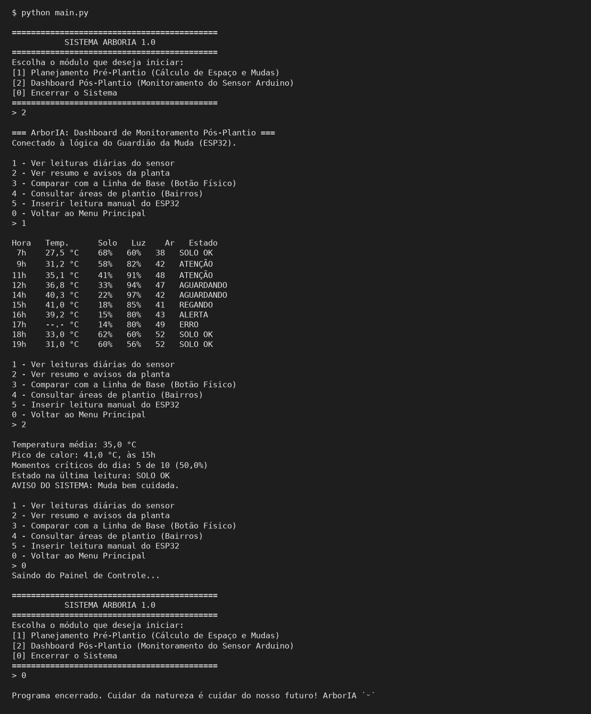

# Lógica · O Cérebro da CitizenTech

Parte de **Computational Thinking with Python** da CitizenTech **ArborIA · Guardião da Muda**.

## O que o programa faz

O ArborIA é um sistema em Python com um Menu Principal que leva a dois módulos. No **Pré-plantio**, o programa recebe o porte da árvore (ou a largura do espaço livre) e a quantidade de mudas, calcula o espaçamento ideal e a área total de solo, e classifica o tamanho da obra com dicas de benefício ambiental. No **Pós-plantio**, ele recebe as leituras do Guardião da Muda (ESP32): umidade do solo, temperatura, luz e qualidade do ar. Com elas, classifica o estado da muda com a mesma lógica do microcontrolador e entrega ao cidadão um aviso como "Muda bem cuidada." ou "Sem água? Peça ajuda!".

## Como rodar

1. Instale o Python 3.10 ou superior (o código usa `match/case`; nenhuma biblioteca externa é necessária).
2. Abra esta pasta no terminal ou no PyCharm.
3. Rode:

```bash
python main.py
```

## De onde vêm os dados

- **Grandeza medida:** temperatura em °C, umidade do solo em %, luz em % e índice de qualidade do ar (0 a 100)
- **Quantidade de registros:** [mínimo 10]
- **Origem:** simulados pela equipe (leituras do Guardião da Muda, linha de base do dia do plantio e dados de bairros do Rio de Janeiro)

## Faixas de decisão

Os mesmos limites usados no circuito de Edge e os mesmos textos da página.

**Pós-plantio · estado da muda** (a regra é avaliada de cima para baixo):

| Faixa | Condição | Aviso para o cidadão |
|---|---|---|
| ERRO | temperatura fora de -10 °C a 60 °C | Verificar sensor! (Leitura de temperatura inválida). |
| SOLO OK | solo ≥ 60% | Muda bem cuidada. |
| ATENÇÃO | solo ≥ 30% (≥ 40% se temperatura ≥ 36 °C) e < 60% | Solo secando. Fique de olho. |
| ALERTA | solo abaixo do limite seco e 2 ou mais tentativas de rega | Sem água? Peça ajuda! (Arduino tentou regar mas o solo continua seco). |
| AGUARDANDO | solo abaixo do limite seco e luz ≥ 90% | Esperando o sol baixar para regar (Evitando evaporação). |
| REGANDO | solo abaixo do limite seco, luz < 90% e menos de 2 tentativas | Regando a muda (Válvula acionada). |

**Pré-plantio · porte da árvore:**

| Porte | Espaçamento | Espaço livre indicado |
|---|---|---|
| Pequeno | 4,0 m | 150 a 249 cm |
| Médio | 7,0 m | 250 a 399 cm |
| Grande | 10,0 m | a partir de 400 cm |

**Pré-plantio · classificação da obra:**

| Área total | Classificação |
|---|---|
| até 500 m² | Plantio doméstico (quintal, praça pequena) |
| até 2.000 m² | Plantio médio (condomínio, rua arborizada) |
| até 10.000 m² | Plantio grande (parque, sítio) |
| acima de 10.000 m² | ALERTA: acima de 1 hectare, exige planejamento |

## Resumo calculado

- **Pré-plantio (opção 3):** quantidade de plantios registrados, área média, maior área e % de plantios em alerta.
- **Pós-plantio (opção 2):** temperatura média (ignorando leituras com ERRO), pico de calor e a hora em que ocorreu, momentos críticos do dia (REGANDO, AGUARDANDO, ALERTA e ERRO) em quantidade e em %, estado na última leitura e aviso do sistema.
- **Contas extras:** comparação da média de temperatura e do ar com a linha de base do dia do plantio (opção 3 do Pós-plantio) e aviso por bairro, a partir da proporção de áreas com nota alta (opção 4).

## Integração com as outras partes

| Parte | Como conversa com o Python |
|---|---|
| Sensor · Edge | os registros simulam as leituras do ESP32; o estado da muda usa a mesma lógica embarcada no microcontrolador e a linha de base vem do botão físico |
| Experiência · STXD | [as opções do menu saíram da jornada do cidadão] |
| Interface · Front-end | [as mensagens impressas são os textos da página] |
| Interação · Web Dev | [a regra de decisão foi reescrita em JavaScript] |
| Pitch · Storytelling | [o programa rodando aparece no vídeo] |

## Execução

[Cole aqui um print do programa rodando: o menu, a opção 1 e o resumo.]



## Antes de enviar

- [ ] O programa roda do início ao fim, e o menu só termina no **0 - Sair**
- [ ] A lista tem 10 ou mais registros do problema da equipe
- [ ] Cada registro é classificado com `if/elif/else`, com faixas que fazem sentido
- [ ] O resumo mostra média, maior valor e % de leituras em alerta
- [ ] Letra, número fora do menu e Enter vazio não derrubam o programa
- [ ] Faixas e avisos iguais aos do circuito e da página
- [ ] Este README está preenchido, com print, e o `prompts.md` está atualizado
- [ ] Todos os integrantes sabem explicar qualquer linha do `main.py`